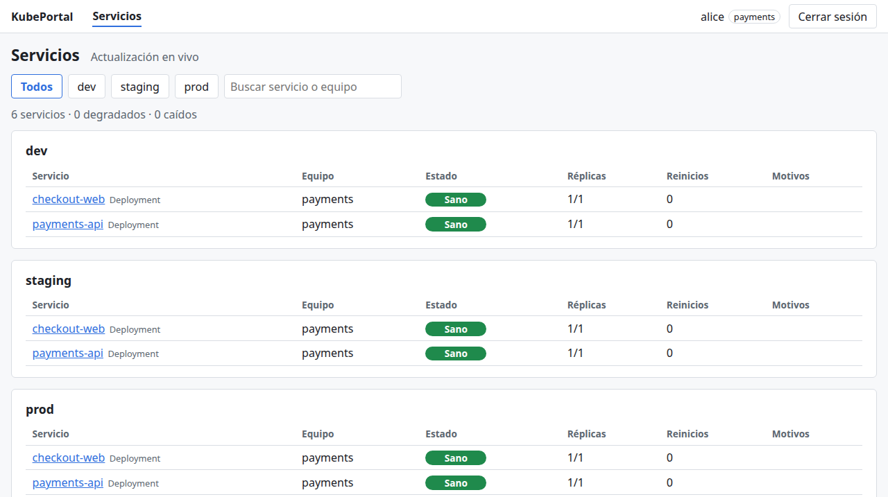
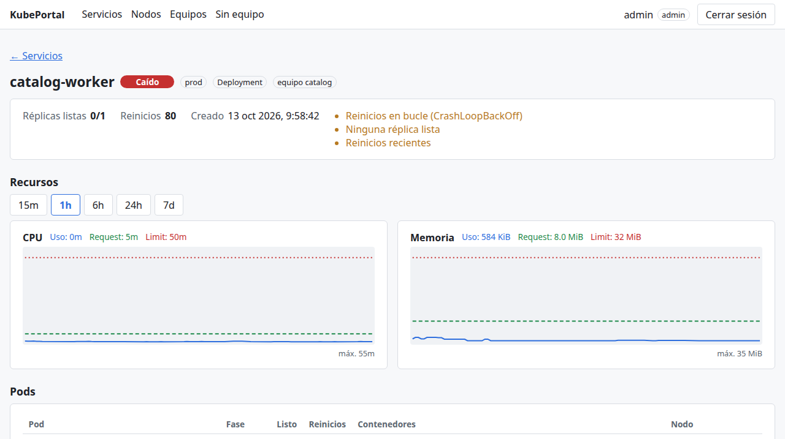
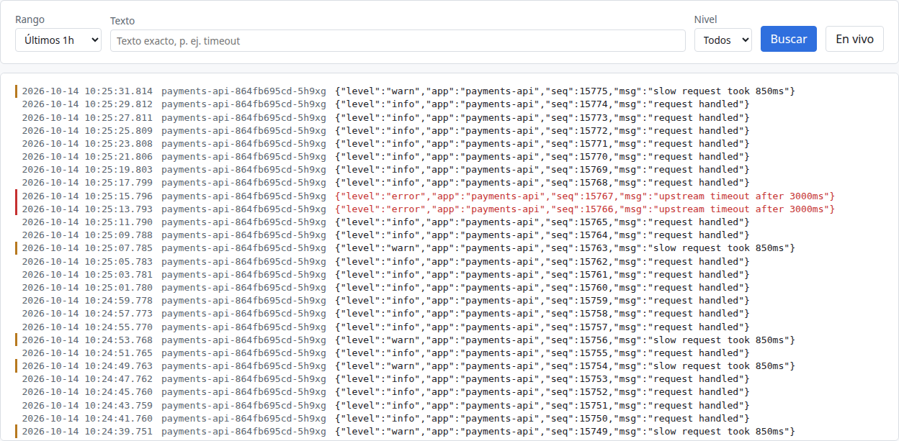
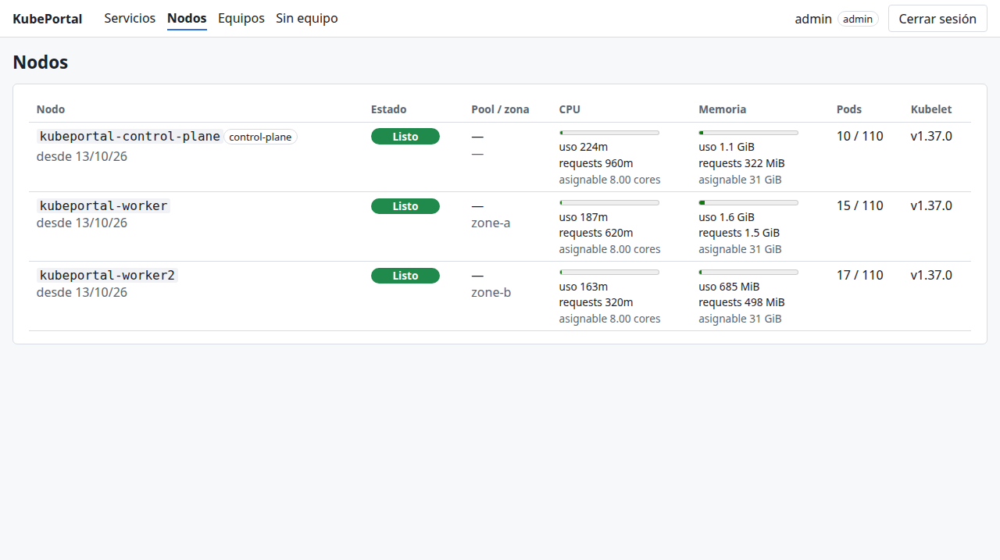
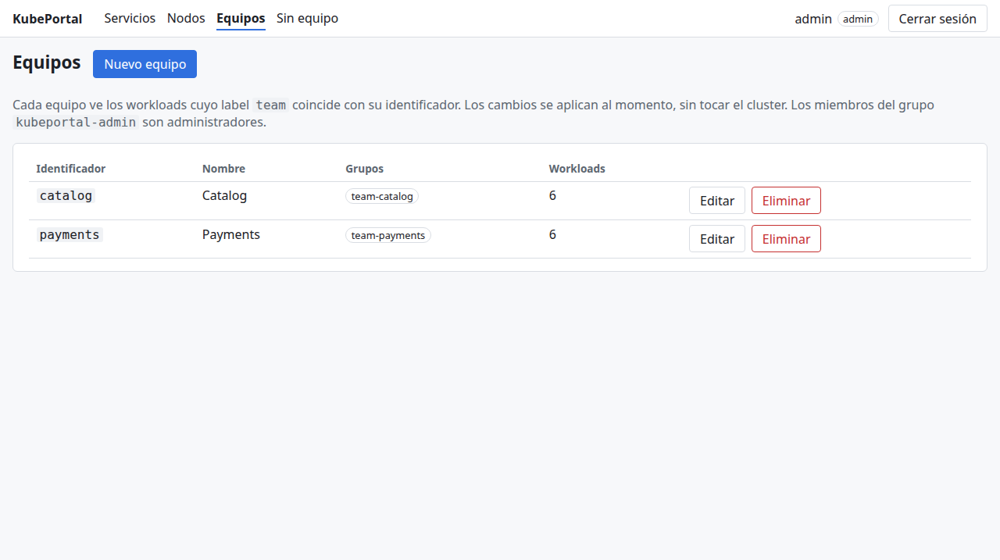

# KubePortal (nombre provisional)

Portal web de autoservicio para Kubernetes: cada equipo inicia sesión y ve **solo** los logs y la salud de sus servicios, sin acceso a Grafana, `kubectl` ni kubeconfig. El administrador ve además los nodos y decide qué grupos forman cada equipo.



## Qué hace

- **Servicios del equipo**: Deployments y StatefulSets con su estado (Sano, Degradado, Caído) y los motivos (CrashLoopBackOff, OOMKilled, réplicas sin estar listas…), actualizados en vivo.
- **Detalle de cada servicio**: pods, eventos de advertencia y CPU/RAM frente a requests y limits, con histórico.
- **Logs**: búsqueda por texto, nivel y rango, y modo en vivo.
- **Administración**: nodos con uso real frente a requests y capacidad; alta de equipos y su mapeo de grupos de Keycloak (se aplica al momento, sin tocar el cluster); workloads sin equipo.

| | |
|---|---|
|  |  |
|  |  |

## Cómo aísla a los equipos

Cada workload lleva un label `team`. El backend es el único que habla con Kubernetes, Loki y Prometheus, y `internal/authz` construye todas las consultas con los equipos del usuario: el navegador nunca envía LogQL, PromQL ni selectores. Un usuario sin equipo no ve nada y un workload sin label solo lo ve el administrador. Hay tests de aislamiento para cada endpoint y un e2e que lo comprueba en un cluster real (kind).

Seguridad en breve: login con Keycloak (OIDC, patrón BFF; los tokens nunca llegan al navegador), cookie `HttpOnly`/`SameSite=Strict`, CSP estricta, ServiceAccount de solo lectura sin acceso a Secrets, imagen distroless sin shell, Pod Security `restricted`, NetworkPolicy de denegación por defecto, e imagen y chart firmados con cosign. Detalle en el [modelo de seguridad](docs/security-model.md).

## Probarlo en local (kind)

Requiere Docker, kind, kubectl, Helm, Go y Node.js (ver [desarrollo](docs/development.md)).

```bash
make dev-up        # cluster kind con Loki, Prometheus, Keycloak, PostgreSQL y apps de ejemplo
make dev-deploy    # construye e instala el portal
make dev-forward   # portal en http://localhost:8080 y Keycloak en :8180 (deja la terminal abierta)
grep DEMO_USER_PASSWORD .kind/secrets.env
```

Usuarios de ejemplo: `alice` (equipo payments), `bob` (catalog), `dave` (search, sin equipo hasta que el admin lo crea), `carol` (sin grupo) y `admin`. `make dev-e2e` comprueba el aislamiento de punta a punta.

## Instalar en un cluster

Imagen y chart se publican en GHCR firmados con cosign; el chart fija la imagen por digest. Con Keycloak, la base de datos y los Secrets listos:

```bash
helm install kubeportal oci://ghcr.io/r0cker64/charts/kubeportal --version <versión> \
  -n kubeportal -f values.yaml
```

La [guía de instalación](docs/installation.md) cubre los prerrequisitos (con un script de verificación de solo lectura), Cloud SQL, Keycloak con su operador, los Secrets, la instalación con Flux o con Helm y el acceso.

## Documentación

- [Instalación](docs/installation.md)
- [Desarrollo local](docs/development.md)
- [Arquitectura](docs/architecture.md)
- [Modelo de seguridad](docs/security-model.md)
- [Roadmap](docs/roadmap.md)
- [Decisiones de arquitectura (ADR)](docs/adr/README.md)
- [Política de seguridad](SECURITY.md)

## Stack

Go (`net/http`, client-go con informers), Angular, Keycloak, Loki, Prometheus, PostgreSQL, Helm y Flux.
